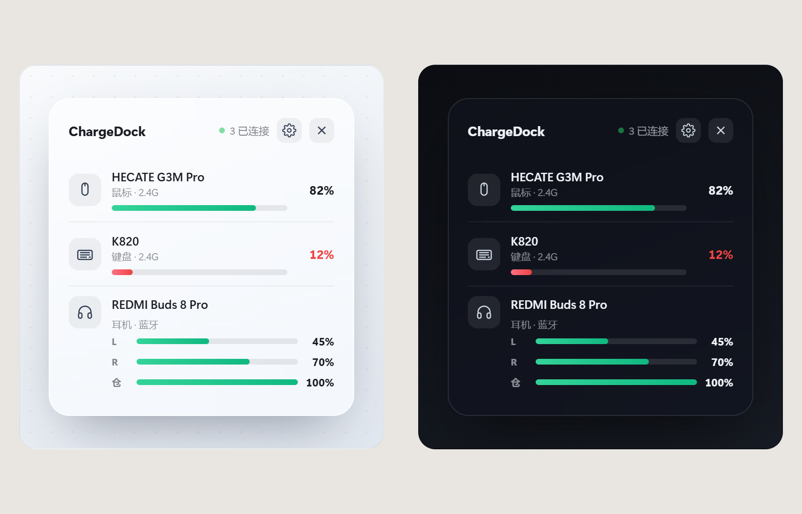
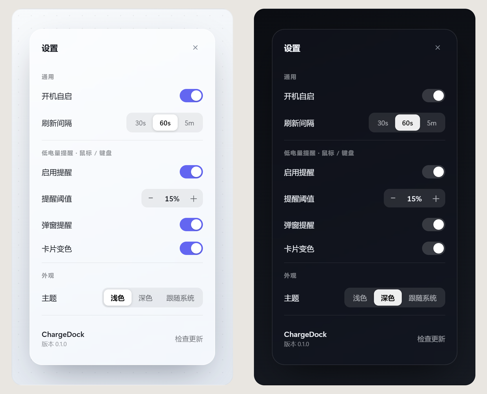
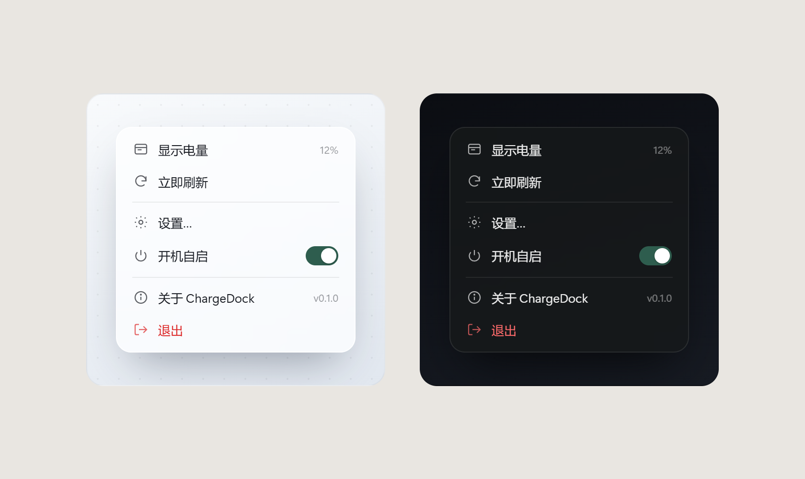

<div align="center">

# ChargeDock

**常驻桌面的个人外设电量卡片**

抬眼即可看到无线鼠标 / 键盘 / 耳机的电量 —— 不用再翻系统设置。

[](https://dotnet.microsoft.com/)
[]()
[]()
[]()
[](LICENSE)



*玻璃拟态 · 深浅主题 · 托盘常驻 · 开机自启*

</div>

---

## 目录

- [为什么做它](#为什么做它)
- [特性](#特性)
- [支持设备](#支持设备)
- [截图](#截图)
- [快速开始](#快速开始)
- [从源码构建](#从源码构建)
- [目录结构](#目录结构)
- [技术栈](#技术栈)
- [设计取舍](#设计取舍)
- [常见问题](#常见问题)
- [License](#license)

---

## 为什么做它

无线外设的电量藏得很深：系统设置 → 蓝牙 → 设备 → 属性，鼠标走 2.4G 接收器时甚至根本看不到电量。
ChargeDock 只做一件事 —— **把电量摆在你眼前**：平时只是一个托盘图标，点一下弹出一张卡片，用完即走。

> 产品灵感来源：[MouseDock](https://mousedock.app) 的视觉与交互（不追其体量）。设计文档见 [`docs/产品设计文档.md`](docs/产品设计文档.md)。

---

## 特性

| | 特性 | 说明 |
| --- | --- | --- |
| 🪟 | **玻璃拟态卡片** | 圆角 22px + 半透明玻璃底 + 投影，深浅两套主题，跟随系统 |
| 🖱️ | **鼠标 / 键盘电量** | HECATE G3M Pro 走 2.4G 私有 HID 主动查询；键盘无固件上报则自动隐藏 |
| 🎧 | **耳机左右耳独立** | REDMI Buds 8 Pro 走 BLE GATT，左右耳分别显示，只戴一只只显示那一侧 |
| 📌 | **托盘常驻 · 右下角置顶** | 不占任务栏、不抢焦点；点击托盘即弹出 / 收起 |
| 🎬 | **顺滑动效** | 卡片整体从任务栏上沿滑入滑出；切换页面有横向滑入 + 淡入；高度变化平滑伸缩 |
| 🔔 | **低电量提醒** | 鼠标 / 键盘 ≤ 15% 时卡片变色 + 气泡弹窗（耳机不打扰） |
| 🚀 | **开机自启** | 一键写入 `HKCU\...\Run`，托盘菜单 / 设置页均可开关 |
| 🎨 | **自绘图标** | 托盘环形电量仪表、设备 / 功能图标全部矢量绘制，无外部资源依赖 |
| 💾 | **单文件 · 免安装** | 自包含单文件 EXE，解压即用；配置存注册表 `HKCU\Software\ChargeDock` |

---

## 支持设备

| 设备                       | 读取方式                                 | 显示       | 状态      |
| ------------------------ | ------------------------------------ | -------- | ------- |
| **HECATE G3M Pro**（鼠标）   | 2.4G 接收器私有 HID 主动查询（已逆向帧格式 + CRC 校验） | 1 个电量    | ✅ 可用    |
| **REDMI Buds 8 Pro**（耳机） | BLE GATT `0x180F` / `0x2A19`         | 左 / 右耳独立 | ✅ 可用    |
| 耳机充电仓                    | —                                    | 能读到则显示   | ⏳ 通道未逆向 |
| **K820**（键盘）             | 固件不上报电量                              | —        | ❌ 暂不支持  |

> 只显示**已连接**的设备：读不到读数的设备不会占位，连接后自动出现。

---

## 截图

| 主卡片                     | 设置页                         | 托盘菜单                    |
| ----------------------- | --------------------------- | ----------------------- |
|  |  |  |

> 设计稿见 [`docs/ui-design-v2.html`](docs/ui-design-v2.html)、[`docs/UI设计文档.md`](docs/UI设计文档.md)。

---

## 快速开始

### 方式一：安装版（推荐）

1. 从 [Releases](../../releases) 下载 **`ChargeDock-Setup.exe`**
2. 双击安装（可勾选创建桌面快捷方式），自动装到 `%LOCALAPPDATA%\Programs\ChargeDock\`
3. 安装完自动启动，托盘出现环形电量图标即成功

> 会注册到「设置 → 应用」，可直接在系统设置里卸载；也支持 `ChargeDock-Setup.exe /uninstall` 静默卸载，或运行 `build\uninstall.ps1`。

### 方式二：便携版（免安装）

1. 下载 **`ChargeDock.exe`**（自包含单文件）
2. 放到任意目录（建议 `%LOCALAPPDATA%\Programs\ChargeDock\`）
3. 双击运行 —— 托盘出现环形电量图标即成功

> 免安装、不写卸载信息，删掉文件即完成卸载。首次运行若出现 SmartScreen 提示，点「更多信息 → 仍要运行」。

### 方式三：从源码构建

```powershell
git clone <repo> && cd ChargeDock
.\build\portable.ps1    # 编译 + 测试 + 发布便携版并部署
.\build\publish.ps1     # 编译 + 测试 + 发布安装版 ChargeDock-Setup.exe
```

---

## 从源码构建

**前置条件**：Windows 10 1809+ / Windows 11，[.NET 8 SDK](https://dotnet.microsoft.com/download/dotnet/8.0)

```powershell
.\build\build.ps1        # 还原 + 编译（Release）+ 跑 45 个 xUnit 测试
.\build\portable.ps1     # 发布自包含单文件 + 部署 + 创建桌面快捷方式
.\build\run-tests.ps1    # 只跑测试
```

发布产物：`artifacts\publish\ChargeDock.exe`（自包含单文件，约 60 MB）

---

## 目录结构

```
src/
├─ ChargeDock.Core/          # 纯业务逻辑（net8.0，零 Windows 依赖，100% 可单测）
│  ├─ BatteryReading.cs      # 读数快照（设备 / 电量 / 左右耳）
│  ├─ IBatteryReader.cs      # 设备读取器统一接口 —— UI 只依赖它
│  ├─ LowBatteryPolicy.cs    # 低电量策略（15%，仅鼠标 / 键盘）
│  └─ DeviceDisplayPolicy.cs # 只显示已连接设备、排序规则
├─ ChargeDock.Devices/       # 设备层（BLE + HID，不碰 UI）
│  ├─ MouseReader.cs         # HECATE G3M Pro 2.4G 私有协议
│  ├─ HeadsetReader.cs       # REDMI Buds 8 Pro BLE GATT
│  ├─ KeyboardReader.cs      # K820（固件无上报）
│  └─ HidFrame.cs            # 鼠标查询帧（纯字节逻辑，可单测）
├─ ChargeDock.App/           # WPF 壳
│  ├─ Program.cs             # 入口 / 单实例 / 托盘线程 / 定时刷新
│  ├─ Flyout.cs              # 悬浮卡片（动画 / 主题 / 设置页）
│  ├─ TrayMenu.cs            # 玻璃风格右键菜单
│  ├─ Theme.cs / Settings.cs / TrayIconFactory.cs / GlassEffect.cs
└─ ChargeDock.Installer/     # 可选安装器（内嵌主程序）
tests/
└─ ChargeDock.Tests/         # xUnit（45 个用例）
website/
└─ index.html                # 官网页（本仓库自带，可直接部署静态托管）
```

**架构边界**：UI 壳只依赖 `IBatteryReader` / `BatteryReading`，设备层与核心逻辑对 UI 零引用 —— 换壳（WinUI 3）时设备层不用改。

---

## 技术栈

| 层 | 选型 | 说明 |
| --- | --- | --- |
| 语言 / 运行时 | C# · **.NET 8 LTS** | 长期支持，自包含单文件发布 |
| UI | **WPF** | 托盘互操作 + 单窗口卡片最稳；`WindowChrome` + 分层窗口实现真玻璃与圆角 |
| 设备访问 | `Windows.Devices.Bluetooth` + SetupAPI P/Invoke | BLE GATT 读电量；2.4G 接收器走 HID 主动查询 |
| 托盘 | WinForms `NotifyIcon` + GDI+ 自绘 | WPF 无原生托盘；图标为环形仪表 |
| 动效 | WPF `TranslateTransform` / `DoubleAnimation` | GPU 合成，不逐帧动窗口，避免卡顿 |
| 测试 | **xUnit** | 业务规则脱离真机单测，45 用例全绿 |
| 配置 | 注册表 `HKCU\Software\ChargeDock` | 免配置文件、免管理员权限 |

---

## 设计取舍

- **卡片的“玻璃”是自绘半透明底，而非系统级模糊。**
  真亚克力（`DWMWA_SYSTEMBACKDROP_TYPE`）会把玻璃画在窗口层、内容之上才能动，导致「卡片不动、只有内容在滑」。最终选择**分层窗口 + 卡片自绘玻璃底**：整卡（底 + 内容）一起做 GPU 平移，动效丝滑、圆角可控，代价是没有背景模糊。
- **动效一律动内容，不动窗口。**
  逐帧 `SetWindowPos` 重定位窗口会明显掉帧；动画全部落在 WPF 元素的 `RenderTransform` / `Opacity` 上。
- **窗口高度由内容根节点测量驱动，并做 220ms 缓动。**
  卡片被窗口拉伸，`card.DesiredSize` 不可靠，因此测量内容 `root` 的自然高度；由 `bodyPanel.SizeChanged` 触发，保证设备行出现/消失、切页时高度平滑伸缩。
- **低电量只提醒鼠标 / 键盘。**
  耳机电量波动大且换电频繁，提醒没有价值，按产品文档明确排除。
- **不做的**：账号、付费、多品牌通用适配、跨平台。

---

## 常见问题

**Q：为什么只支持这几台设备？**
按产品定位只覆盖自用的三台外设，新设备再补，不提前铺摊子。接入新 BLE 设备只需实现 `IBatteryReader`。

**Q：托盘图标不显示 / 卡片不出来？**
确认 `ChargeDock.exe` 所在目录可写（配置写 `HKCU` 注册表，无需管理员）。若从受限目录运行，托盘线程可能失败，建议放 `%LOCALAPPDATA%\Programs\ChargeDock\`。

**Q：为什么键盘没有电量？**
K820 固件不上报电量，属设备限制，读不到就不显示。

**Q：支持浅色模式吗？**
支持。设置页 → 外观 → 浅色 / 深色 / 跟随系统，默认跟随系统。

---

## License

[MIT](LICENSE) © ChargeDock
